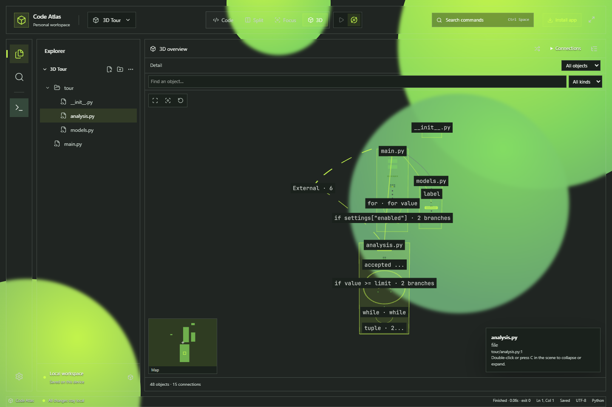
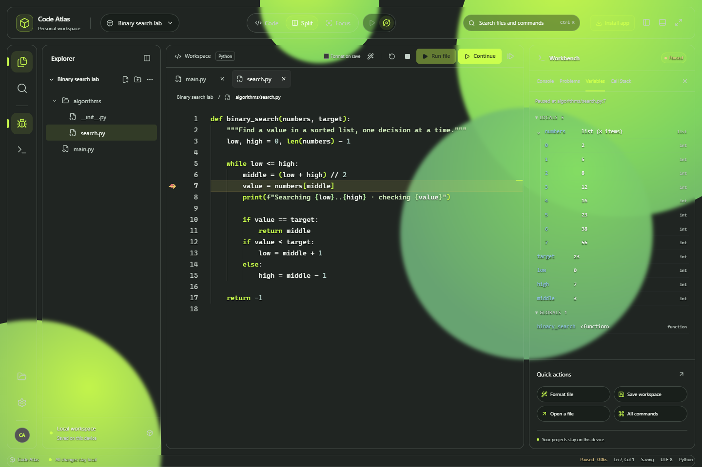

# Custom-IDE

**Code Atlas** is a Python IDE for your browser and Windows desktop, with a transparent workspace.

Write and run multi-file projects, debug step by step and explore your code in an
interactive 3D overview. Your projects stay saved on your device.

